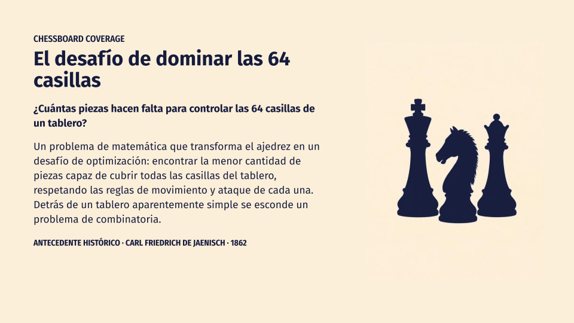

# cobertura-tablero-ajedrez

Busca configuraciones de piezas capaces de cubrir todas las casillas de un tablero de ajedrez de 8 × 8. Presenta las configuraciones encontradas y permite recorrerlas o filtrar las que tienen cobertura fuerte en todo el tablero.



## Problema

Se ubican ocho piezas (una dama, un rey, dos torres, dos alfiles y dos caballos) en zonas predefinidas del tablero. El programa prueba posiciones aleatorias y conserva una configuración cuando cada casilla recibe al menos un ataque. A partir de una configuración válida, también genera variantes mediante rotaciones, espejado e intercambio de las torres.

No se simula una partida ni se busca jaque mate: es un problema estático de cobertura con restricciones de ubicación. La dama y un alfil se ubican en el bloque central de 2 × 2; el otro alfil y los caballos, en el anillo de 4 × 4; el rey, en el anillo de 6 × 6; y una torre, en el borde. La segunda torre puede ubicarse en cualquiera de esos tres anillos exteriores.

Los términos **ataque débil** y **ataque fuerte** significan:

- Un **ataque débil** indica que una pieza alcanza la casilla según sus movimientos. Para dama, torre y alfil, también se marcan como débiles las casillas que quedan detrás de otra pieza en la misma línea.
- Un **ataque fuerte** (o fatal) es el que llega sin bloqueo por una línea de dama, torre o alfil. La primera pieza que bloquea la línea también queda atacada fuertemente; las casillas posteriores solo débilmente.

Con esas definiciones, una configuración se clasifica como:

- `NO_SOLUCION`: queda al menos una casilla sin atacar.
- `LEVE`: todas las casillas reciben algún ataque, pero no todas reciben uno fuerte.
- `FATAL`: todas las casillas reciben al menos un ataque fuerte.

## Ejecutar

Desde la raíz del repositorio, en PowerShell:

```powershell
dotnet restore .\CoberturaTableroAjedrez.sln
dotnet run --project .\src\CoberturaTableroAjedrez\CoberturaTableroAjedrez.csproj
```

## Estructura

```text
.
├── CoberturaTableroAjedrez.sln
├── README.md
├── docs
│   ├── arquitectura
│   │   ├── diagrama-clases.eap
│   │   ├── diagrama-formularios.pdf
│   │   └── modelo-dominio.pdf
│   └── historial
│       └── ideas-iniciales-formulario.txt
└── src
    └── CoberturaTableroAjedrez
        ├── CoberturaTableroAjedrez.csproj
        ├── Program.cs
        ├── Aplicacion
        │   └── GeneradorDeSoluciones.cs
        ├── Dominio
        │   ├── Alfil.cs
        │   ├── Caballo.cs
        │   ├── Casilla.cs
        │   ├── ConfiguracionTablero.cs
        │   ├── Ficha.cs
        │   ├── Reina.cs
        │   ├── Rey.cs
        │   ├── Tablero.cs
        │   └── Torre.cs
        ├── Presentacion
        │   ├── FormularioInicio.cs
        │   ├── FormularioInicio.Designer.cs
        │   ├── FormularioInicio.resx
        │   ├── FormularioSoluciones.cs
        │   ├── FormularioSoluciones.Designer.cs
        │   └── FormularioSoluciones.resx
        ├── Properties
        │   ├── Resources.Designer.cs
        │   └── Resources.resx
        └── Recursos
            ├── ColoresTablero.txt
            └── Piezas
```

## Colaboras

- [Victoria Guarnieri](https://github.com/vickyguar)
- [Manuela Velloso](https://github.com/manuvelloso)
